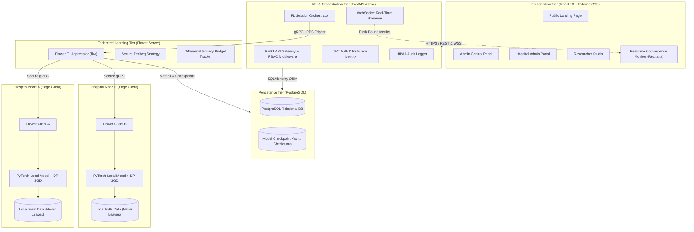
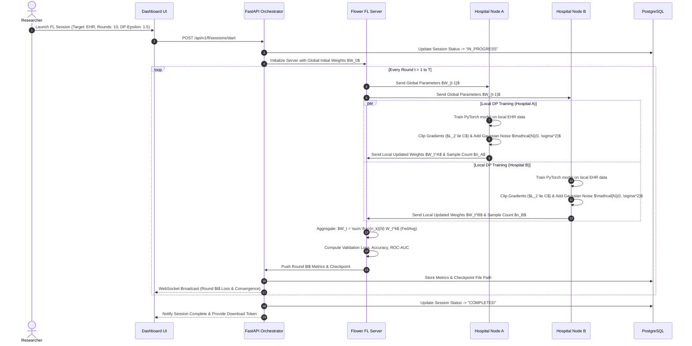

# System Architecture: Secure Collaborative Healthcare Learning System

## 1. Executive Summary

The **Secure Collaborative Healthcare Learning System** is a decentralized, privacy-preserving machine learning platform engineered for clinical institutions (hospitals, diagnostic centers, research institutes). It enables cross-institutional model training without sharing confidential Electronic Health Records (EHR) or patient identifiable information (PII).

The platform addresses three core challenges in modern healthcare AI:

1. **Data Silos & Scarcity:** Individual hospitals lack sufficient data diversity for rare or heterogeneous diseases.

2. **Regulatory & Privacy Mandates:** HIPAA, GDPR, and local privacy laws penalize centralization of sensitive medical records.

3. **Model Inversion & Reconstruction Attacks:** Even without sharing raw data, naive sharing of model gradients can leak patient records. The platform counters this via **Differential Privacy (DP-SGD)** and **Secure Parameter Aggregation (FedAvg)**.

---

## 2. Architecture Overview

---

## 3. Core Subsystems

### 3.1. Frontend Tier (`frontend/`)

- **Technology:** React.js, Tailwind CSS, Recharts, Lucide Icons, Vite.

- **Role-Based Views:**

  - **Super Admin:** Institution approvals, system telemetry, global audit trails, user RBAC management.

  - **Hospital Administrator:** Local node configuration, local dataset schema validation, privacy budget allowance, client heartbeat.

  - **Researcher:** Experiment creator, hyperparameter tuning ($\varepsilon, \delta$, clipping norm, rounds), real-time loss/accuracy monitoring, model checkpoint download.

- **Telemetry:** WebSocket connection for real-time loss curves, ROC-AUC, round times, and client participation indicators.

### 3.2. Backend & API Tier (`backend/`)

- **Technology:** FastAPI, Pydantic v2, SQLAlchemy 2.0, Alembic, Python-JOSE (JWT), Passlib/Bcrypt.

- **Security & Authorization:**

  - Token-based stateless authentication (JWT with expiration and refresh mechanism).

  - Fine-grained RBAC decorators (`@require_roles(["admin"])`).

  - Request verification, rate-limiting, and input sanitization.

- **WebSocket Streaming:**

  - Pushes live round-by-round training metrics to active research sessions.

### 3.3. Federated Learning Core (`federated/`)

- **Technology:** Flower Framework (`flwr`), gRPC.

- **Strategy:** Federated Averaging (`FedAvg`) extended with:

  - Minimum client threshold enforcement.

  - Validation metrics aggregation (weighted by client dataset sizes).

  - Fault tolerance (straggler mitigation and dropped client recovery).

### 3.4. Machine Learning & Privacy Layer (`ml/` & `federated/privacy/`)

- **Technology:** PyTorch, Scikit-learn, NumPy.

- **Differential Privacy (DP):**

  - **Gradient Clipping:** Clips the $L_2$ norm of gradients at threshold $C$:

    $$g \leftarrow g / \max\left(1, \frac{\|g\|_2}{C}\right)$$

  - **Calibrated Noise Injection:** Gaussian noise calibrated against privacy parameters $(\varepsilon, \delta)$:

    $$\sigma = \frac{\sqrt{2\ln(1.25/\delta)} \cdot C}{\varepsilon}$$

  - **Privacy Budget Accounting:** Tracks cumulative $(\varepsilon, \delta)$ spent across rounds to guarantee strict privacy guarantees.

- **Clinical Task Models:**

  - Tabular MLP for EHR risk stratification (e.g., Diabetes/Cardiovascular/Sepsis classification).

  - Convolutional Neural Network (CNN) architecture designed for medical imaging (e.g., Chest X-Ray pneumonia classification).

---

## 4. Sequence: A Single Federated Training Round

